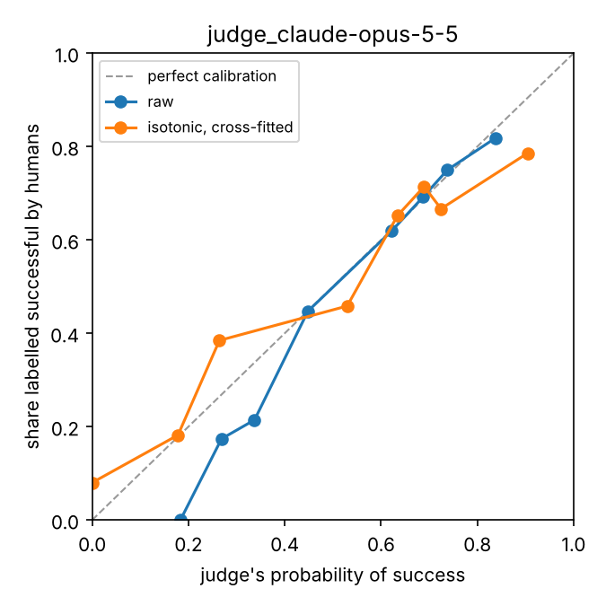

# teleop-qc

Quality control for robot teleoperation data, treated as an ML problem: signal checks and calibrated VLM judges,
on [DROID](https://huggingface.co/datasets/lerobot/droid_1.0.1) streamed from the Hugging Face Hub.

Robot learning runs on teleoperation data, and a bad episode costs twice: once when it is collected, and again
when a policy learns from it. This repository checks episodes the way a data pipeline has to before shipping them,
and measures how far each check can be trusted.

## What it checks

1. **Signals**, before any model looks at the data: dropped, repeated or reversed timestamps, frame counts, frozen
   and dark frames, and the time lag between each camera and the robot's joint encoders, estimated by
   cross-correlating image motion with joint speed (the idea behind camera-IMU time calibration).
2. **Outcomes, with VLM judges**: a vision-language model sees a grid of frames (3 cameras, 6 moments) and says
   whether the robot completed the task it was attempting, how confident it is, and what went wrong. The judge
   checks its own structured answer and abstains rather than guesses.
3. **Trust in the judges**: their probabilities are calibrated against the human success labels of DROID
   (reliability diagrams, ECE, AUROC, agreement), recalibrated (Platt, isotonic), and turned into the thresholds
   at which episodes can be accepted or rejected without human review, with the cost per hour of video.

DROID 1.0.1 has 95,658 episodes from 3 cameras (AV1, 320x180, 15 fps), Apache-2.0. Each 500 MB video file holds
about 300 episodes; the code reads only the byte ranges of the frames it needs, so checking an episode never means
downloading a file.

## First findings on DROID 1.0.1

**The metadata gives the label away.** In the first metadata file (14,153 episodes), 94.6% of the episodes
labelled successful have a language instruction, against 0.3% of the failed ones: the instructions were
crowdsourced after collection, mostly for successful episodes. A judge shown the instruction could read the label
off its mere presence, so the judges here never see it. The `task_category` field holds lab and building names
("Autolab", "BAIR", street addresses), not task categories.

The numbers below come from the 327 episodes of the first video file (1.8 hours of episodes, 5.3 hours of video
over the 3 cameras); the per-stream results are in [`results/signals_droid_file000.csv`](results/signals_droid_file000.csv).

**The containers are clean.** Every one of the 981 streams has the expected number of frames, with no timestamp
gap, repeat or reversal and no frozen frame. Dark frames appear only on the wrist camera, in 8 episodes; in the
worst one, 59% of the frames, the camera works inside a dark space. That is the scene, not a sensor fault, but
those frames tell a judge nothing.

**Each camera has its own lag.** Against the joint encoders, exterior camera 1 shows the arm's motion 0.39 frame
late (median over the 192 streams with a clear correlation peak; interquartile range -0.07 to 0.88), exterior
camera 2 0.41 frame late (170 streams; -0.02 to 0.89), and the wrist camera 0.17 frame early (257 streams; -0.68
to 0.16). At 15 fps that is about 27 ms and -11 ms. A first version of the desync check compared every camera to
zero and flagged 35% to 55% of the streams; judging each camera against its own usual lag leaves 34 of 981
streams (29 episodes) off by 2 to 7 frames. Those are candidates for review, not confirmed faults. In 4 episodes
several cameras shift the same way (episode 252: -2.4, -2.2 and -4.2 frames), which points at the joint states
rather than at the cameras. The flags are unrelated to the outcome: 86% of the flagged episodes succeeded, against
85% overall.

**Throughput.** Decoding alone runs at 334 to 411 frames per second per stream. Streaming, decoding and every
check together processed the 288,000 frames in 31 minutes on one CPU core: about 150 frames per second, or 10
hours of camera video per core-hour.

## Judges

Status: Claude Opus 5.5 has judged the 200 episodes of the eval set (results below); open-weight judges are next.

- Input: one JPEG grid, cameras in columns and 6 evenly spaced moments in rows (968x1100 px, about 1,400 image
  tokens). No instruction, for the reason above.
- Output: JSON with evidence, success, confidence (0.5 to 1) and a failure mode, checked for schema and
  consistency; one retry with the reason, then abstention.
- Backends: Claude through the Anthropic API (default `claude-opus-5-5`, structured outputs, server-side fallback
  when a model declines), and open-weight VLMs through Hugging Face Inference Providers.
- Eval set: 200 episodes, 100 successful and 100 failed, drawn with seed 0 from the first metadata file and frozen
  in [`evals/droid_evalset_v1.jsonl`](evals/droid_evalset_v1.jsonl).
- Reported per judge: balanced accuracy, AUROC with a bootstrap interval, ECE before and after cross-fitted
  isotonic recalibration, share of episodes accepted at 95% precision or rejected at 90% without review, dollars
  per episode and per hour of video.

### Claude Opus 5.5 on the eval set

```bash
teleop-qc judge --evalset evals/droid_evalset_v1.jsonl --out runs/claude-opus-5-5.jsonl     # effort medium
teleop-qc report results/judge_claude-opus-5-5.jsonl --plot results/reliability_claude-opus-5-5.png
```

The verdicts are in [`results/judge_claude-opus-5-5.jsonl`](results/judge_claude-opus-5-5.jsonl), the report in
[`results/report_claude-opus-5-5.txt`](results/report_claude-opus-5-5.txt). The judge answered all 200 episodes at
the first attempt: no abstention, no refusal, no retry.

| Metric | Value |
|---|---|
| Balanced accuracy | 0.755 |
| Successful episodes judged successful | 83.0% |
| Failed episodes judged failed | 68.0% |
| AUROC | 0.811 (95% bootstrap interval 0.747 to 0.868) |
| ECE, 10 bins | 0.064; 0.051 after cross-fitted isotonic recalibration |
| Brier score | 0.179 |
| Episodes accepted without review at 95% precision | 0% |
| Episodes rejected without review at 90% precision | 13.0% |
| Cost | $2.92 for the 200 episodes: $0.015 per episode, $2.89 per hour of episode |



**The judge leans toward success.** It calls 57.5% of the episodes successful when half of them are (a
probability of exactly 0.5 counts as success). It lets 32 of the 100 failures through, 30 of them with a success
verdict and no failure seen, and turns down 17 of the 100 successes. FailBench reports the same bias on ambiguous
evidence. Six moments per camera may miss the moment a grasp slips or an object lands in the wrong place.

**Its confidence is honest, and capped.** Without any recalibration, its probabilities match the human labels
closely (ECE 0.064): the 38 episodes it scores between 0.40 and 0.60 are 44.7% successful, the 26 between 0.68 and
0.72 are 69.2% successful. Isotonic recalibration barely moves it (0.051). But it never goes above 0.92, and its 33
most confident episodes (0.80 to 0.92, mean 0.84) are 81.8% successful: no threshold accepts episodes at 95%
precision. At the other end, the 21 episodes it scores below 0.25 are all failures, and the recalibrated
probabilities reject 13% of the episodes at 90% precision.

**What it means for a pipeline.** This judge alone cannot let an episode into a training set without a human
look, but it can drop about one episode in eight as a failure, and order the review queue so that likely failures
come first (AUROC 0.81), for $2.89 per hour of episode. Next: open-weight judges through Hugging Face, more moments
per camera, and a panel of judges, measured on the same 200 episodes.

## Quick start

```bash
pip install -e ".[dev,judges,plots]"
pytest                 # offline tests
pytest -m network      # also reads real DROID episodes from the Hub

teleop-qc signals --video-file 0 --out runs/signals_file000.parquet     # the findings above, about 30 minutes
teleop-qc evalset --n 200 --out runs/evalset.jsonl                      # same as evals/droid_evalset_v1.jsonl
TELEOP_QC_ANTHROPIC_API_KEY=... teleop-qc judge --evalset evals/droid_evalset_v1.jsonl --out runs/claude-opus-5-5.jsonl
teleop-qc report runs/claude-opus-5-5.jsonl --plot runs/reliability.png
```

The judge reads its key from `TELEOP_QC_ANTHROPIC_API_KEY`, not `ANTHROPIC_API_KEY`, so that it never picks up a
coding agent's own credentials.

## Related work

- DROID: Khazatsky et al., *DROID: A Large-Scale In-The-Wild Robot Manipulation Dataset*, 2024.
- FailBench: Navasardyan, Danielyan and Davtyan, *How Reliable are VLMs at Judging Robot Task Success?*, 2026.
  On 2,197 attempts from 14 sources, the best of 13 VLM detectors reaches 0.77 mean balanced accuracy, with a bias
  toward predicting success when the evidence is ambiguous. teleop-qc looks at what a data pipeline does with a
  judge's score: calibration against human labels, review thresholds, and cost.

## How this repository is built

With a coding agent (Claude Code), under one rule: an agent's work is not done until it is verified. Every check
in `signals.py` has a test that plants the fault it must find, every metric in `calibration.py` is tested against
scikit-learn or a case with a known answer, and the judge loop is tested on scripted answers, valid and broken.

## License

Code: Apache-2.0. Data: DROID, Apache-2.0, by the DROID authors.
